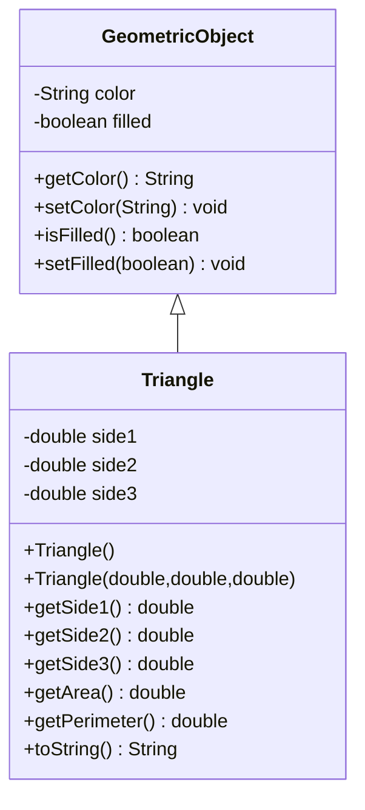

'# Soru 1 - Üçgen Sınıfı
GeometricObject temelinden türeyen Triangle sınıfı kenarlar, alan ve çevre hesaplamalarını sağlar.

İki sınıfı derleyip `q1.Main` çalıştırın. Üç kenar, renk ve dolu bilgisi isteyerek sonuçları görüntüler.'